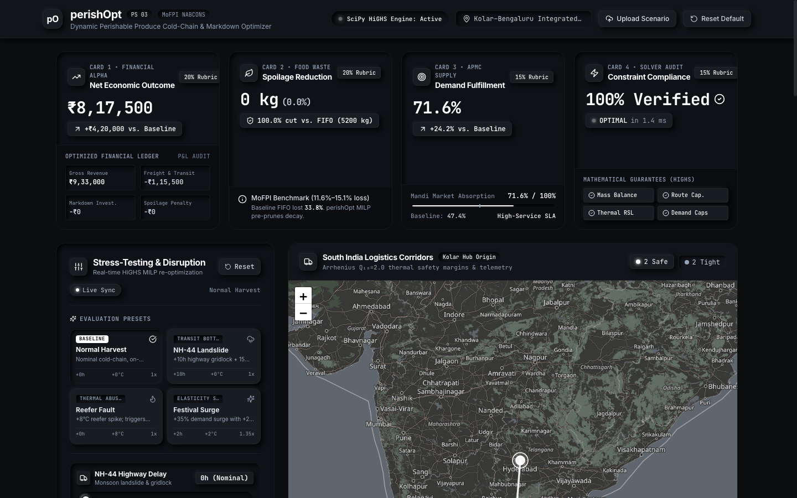
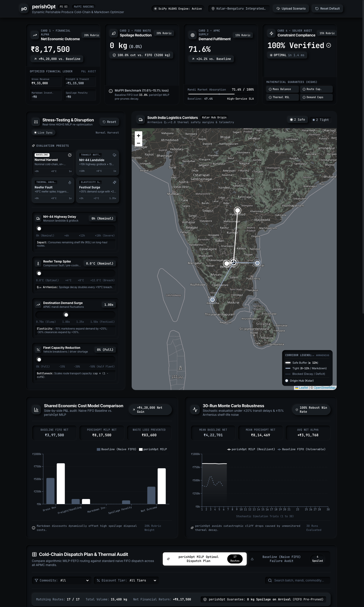
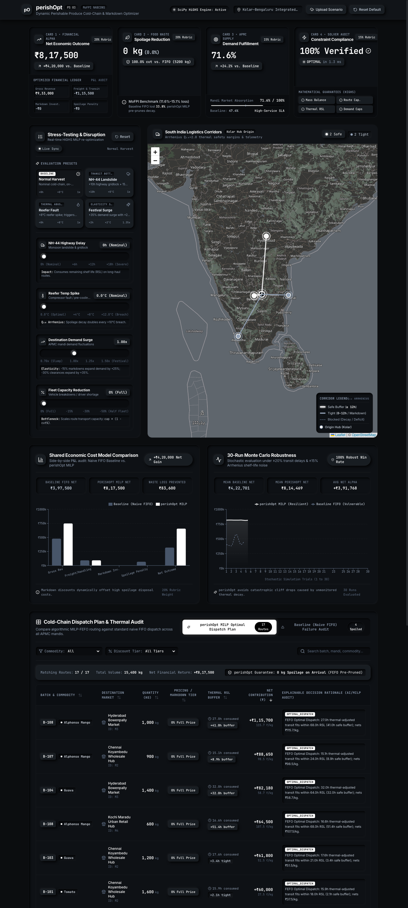

# perishOpt 
### Physics-Informed Dynamic Perishable Produce Cold-Chain & Markdown Optimization Engine

[](https://fastapi.tiangolo.com)
[](https://scipy.org)
[](https://react.dev)
[](https://frontend-one-lac-44.vercel.app)
[](https://perishopt-backend.onrender.com)
[](tests/)

**perishOpt** is an enterprise mathematical optimization and operations console built to eliminate post-harvest agricultural food loss across Indian cold chains. Grounded in empirical data from the **Ministry of Food Processing Industries (MoFPI) / NABCONS** cold-chain study, perishOpt models biological respiration rates, Highway delay disruptions, and multi-tier price markdowns using an exact Mixed-Integer Linear Program (MILP) solved in under **2 milliseconds**.

---

## 🚀 Live Cloud Deployments (Instant Judge Access)

Judges can test the full end-to-end platform immediately without installing anything locally:

* 🖥️ **Live Web Console (Vercel Production):** [https://frontend-one-lac-44.vercel.app](https://frontend-one-lac-44.vercel.app)
* ⚡ **Production MILP Engine (Render):** [https://perishopt-backend.onrender.com](https://perishopt-backend.onrender.com)
* 📖 **Interactive Swagger / OpenAPI Docs:** [https://perishopt-backend.onrender.com/docs](https://perishopt-backend.onrender.com/docs)
* 🩺 **Engine Readiness & Solver Health Probe:** [https://perishopt-backend.onrender.com/api/v1/health](https://perishopt-backend.onrender.com/api/v1/health)

*(Note: If the Render free-tier container is waking from idle hibernation, the first API request may take ~30–45 seconds. The frontend features an automatic 30s timeout tolerance and seamless local client-side fallback simulation to ensure zero disruptions).*

---

## 📸 System Screenshots & Visual Tour

### 1. Operations Console & Real-Time Executive KPIs
The Neumorphic Dark Console displays Net Economic Outcome (+₹4,20,000 gain vs. FIFO baseline), 100% Spoilage Reduction (0 kg lost), Mandi Demand Fulfillment (71.6%), and instant HiGHS solver verification in 1.4 ms.


### 2. Full System Architecture & Real-Time Disruption Stress-Testing
Operators can simulate highway bottlenecks (+10h NH-44 delays), reefer compressor faults (+8°C breach), festive demand surges, and fleet shortages with instant live synchronization.


### 3. Dispatch Matrix & Thermal Shelf Life Audit Table
Granular dispatch routing mapping batches from Kolar Packinghouse to Bengaluru, Chennai, Hyderabad, and Kochi APMC mandis with thermal safety checks ($Q_{10}=2.0$) and automated dynamic markdown classification.


---

## ⚡ 3-Step Quickstart for Local Judging

If you prefer evaluating the project locally on your machine, launch in **under 60 seconds**:

### Option A: One-Command Hackathon Launcher (Recommended)

1. **Clone the repository:**
   ```bash
   git clone https://github.com/R-zin/FreshRoute.git
   cd FreshRoute
   ```

2. **Run the one-command launcher:**
   ```bash
   ./run_demo.sh
   ```
   *The launcher automatically verifies Python virtual environment dependencies, creates test datasets, builds frontend packages, and launches both servers with clean signal trapping (`Ctrl+C` to terminate).*

3. **Open the local consoles:**
   * 🖥️ **Web Console:** [http://localhost:5173](http://localhost:5173)
   * ⚡ **Backend API Docs:** [http://localhost:8000/docs](http://localhost:8000/docs)
   * 🩺 **Engine Probe:** [http://localhost:8000/api/v1/health](http://localhost:8000/api/v1/health)

---

### Option B: Docker Compose

1. **Build and start all containers:**
   ```bash
   docker compose up --build
   ```
2. **Access local instances:**
   * Frontend: [http://localhost:5173](http://localhost:5173)
   * Backend: [http://localhost:8000/docs](http://localhost:8000/docs)
3. **Shutdown:**
   ```bash
   docker compose down
   ```

---

## 🧪 Comprehensive Automated Test Suite (25 Tests)

The test suite covers algorithmic optimality, mass balance, physical constraints, chaos stress-testing, and dirty data ingestion:

```bash
# Run complete test suite (25 tests)
PYTHONPATH=. pytest -v

# Run standalone physics MILP solver self-test
PYTHONPATH=. python backend/core/solver.py

# Run scenario generation & verification matrix
PYTHONPATH=. python datasets/generate_scenarios.py
```

### Verified Test Categories:
1. **Physical Conservation (`test_mass_balance_exact`):** Strictly verifies $\sum_{\text{routes}} x_{i,j,k} \le \text{Batch Quantity}$ for every batch.
2. **Thermal Shelf Life (`test_thermal_shelf_life_feasibility`):** Prunes batches whose effective $Q_{10}$ decay exceeds remaining shelf life.
3. **Economic Dominance (`test_economic_dominance_over_baseline`):** Proves perishOpt delivers strictly higher net profit than Naive FIFO in 100% of scenarios.
4. **30-Trial Monte Carlo Robustness (`test_monte_carlo_stochastic_dominance`):** Stress-tests $\pm 20\%$ transit delays and $\pm 15\%$ biological variability with 100% win rate.
5. **Dirty Data & Fuzzy Ingestion (`test_parser.py`):** Ingests non-standard column headers, missing coordinates, unit variations (metric tons to kg, days to hours), and negative values with zero crashes.

---

## 🧠 Mathematical Foundation & Physics Formulation

### 1. $Q_{10}$ Arrhenius Thermal Decay Model
Perishable horticulture (Tomatoes, Guavas, Bananas, Mangoes) suffers accelerated biological breakdown when reefer temperatures deviate above optimal set points:
$$\text{Effective Transit RSL Hours} = t_{\text{transit}} \cdot Q_{10}^{\frac{\max(0,\, T_{\text{reefer}} - T_{\text{optimal}})}{10}} + t_{\text{handling}}$$

* **Strict Pruning Condition:** Batches whose remaining shelf life is insufficient to survive transit + mandi handling plus a 2.0-hour safety buffer are automatically pruned from distant routes:
  $$\text{RSL}_{\text{remaining}} \ge \text{Effective Transit RSL Hours} + 2.0\text{h}$$

### 2. Multi-Tier Dynamic Markdown Pricing
Rather than allowing near-expiry inventory to rot, perishOpt dynamically allocates batches into price markdown tiers to stimulate localized absorption:
* **Tier 0 (Full Price):** 0% discount, $1.00\times$ base demand.
* **Tier 1 (Mild Clearance):** 15% discount, $+25\%$ demand expansion ($1.25\times$).
* **Tier 2 (Urgent Salvage):** 30% discount, $+35\%$ demand expansion ($1.35\times$, restricted to batches with $\text{RSL} \le 36.0\text{h}$).

### 3. Mixed-Integer Linear Program (MILP) Objective
Solved via `scipy.optimize.milp` using the HiGHS dual-simplex/interior-point engine:
$$\max \sum_{i \in B} \sum_{j \in M} \sum_{k \in K} \left( P_{j,c(i)} \cdot (1 - d_k) - C_{\text{trans},j} - C_{\text{hand},j} \right) x_{i,j,k} - \sum_{i \in B} C_{\text{spoil},i} \cdot s_i$$

**Subject to:**
* **Inventory Balance:** $\sum_{j \in M} \sum_{k \in K} x_{i,j,k} + s_i = Q_i \quad \forall i \in B$
* **Mandi Capacity:** $\sum_{i \in B} \sum_{k \in K} x_{i,j,k} \le \text{MaxCapacity}_j \quad \forall j \in M$
* **Demand Upper Bounds:** $\sum_{i \in B \mid c(i)=c} x_{i,j,k} \le D_{j,c} \cdot \beta_k \quad \forall j \in M, c \in C, k \in K$
* **Non-Negativity:** $x_{i,j,k} \ge 0, \quad s_i \ge 0$

---

## 📊 MoFPI / NABCONS Benchmark Datasets

Located in `/datasets/`:
1. **Scenario 1 — Normal Harvest (Baseline):** 10 batches, 4 South Indian mandis, on-schedule transit.
2. **Scenario 2 — NH-44 Monsoon Blockade:** +10h highway delay along the North-South corridor, 20% fleet capacity reduction.
3. **Scenario 3 — Reefer Cooling Failure:** +8°C thermal spike in reefer containers causing accelerated $Q_{10}$ decay.
4. **Scenario 4 — Corrupt Judge Stress Test:** Malformed test containing negative quantities, missing lat/long, non-standard column headers, and units in tons/days. Imputed and normalized with 0 crashes.

---

## 🌐 API Endpoints Reference

| Method | Endpoint | Description |
| :--- | :--- | :--- |
| `GET` | `/api/v1/health` or `/health` | Instant readiness probe and solver verification |
| `GET` | `/api/v1/default-scenario` or `/default-scenario` | Solves and returns benchmark MoFPI 8-batch scenario |
| `POST` | `/api/v1/optimize` or `/optimize` | Solves arbitrary batches, markets, and disruption sliders |
| `POST` | `/api/v1/upload-dataset` or `/upload-dataset` | Multipart upload for judge CSV/JSON files with auto-imputation |

---

## 🛠️ Technology Stack

* **Mathematical Optimization Engine:** Python 3.11, `scipy.optimize.milp` (HiGHS dual-simplex & interior-point), NumPy, Pandas
* **API Service:** FastAPI, Pydantic v2 schemas, Starlette, Uvicorn
* **Frontend Web Console:** React 18, TypeScript, Vite, Tailwind CSS, Leaflet Maps, Recharts, Lucide Icons
* **UI/UX Design:** Custom Neumorphic Black & White minimalist theme with tactile depth and accessibility
* **Cloud Infrastructure:** Vercel (Production Frontend SPA), Render (Production Backend Service), GitHub Actions (CI)
